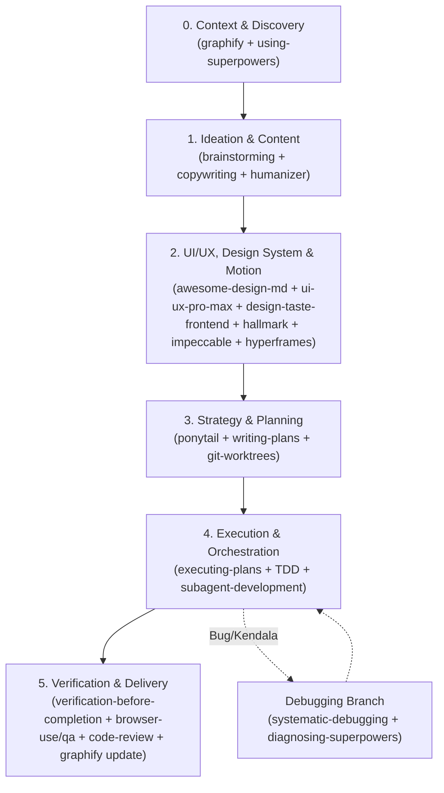

# Workflow: Superpowers Master Pipeline

Gunakan workflow ini saat merancang fitur baru, merombak antarmuka, atau menyelesaikan task teknis end-to-end agar seluruh skill terpakai optimal.



---

## Tahap 1: Query Arsitektur & Context
Sebelum menyentuh kode, petakan dependensi target:
```powershell
# Cek relasi dan model kunci via MCP / CLI
graphify query "<nama fitur atau komponen target>"
```
* **Skill Terlibat:** `graphify`, `using-superpowers`, `antigravity-guide`.
* **Output:** Daftar entitas yang terhubung dan batas arsitektur (*god nodes* & dependensi).

---

## Tahap 2: Brainstorming & Tone of Voice
1. Eksplorasi kebutuhan user dan diskusikan opsi pendekatan menggunakan skill `brainstorming`.
2. Validasi teks antarmuka (copy, pesan error, label button) dengan skill `copywriting` dan `humanizer` untuk memastikan nada tulisan manusiawi dan berkarakter.
3. Gunakan skill `generative_ui` jika memerlukan visualisasi cepat atau wireframe mockup interaktif.
4.gunakan kemampuan `grill_me` untuk menghindari asumsi

---

## Tahap 3: Standar UI/UX, Desain Anti-Slop, & Produksi Visual/Motion
1. **Fondasi `DESIGN.md` & Token Visual**:
   - Gunakan `awesome-design-md` (84 referensi sistem desain brand global di `.agents/skills/awesome-design-md/design-md/`) saat membuat atau merombak `DESIGN.md`.
   - Rujuk token warna, hierarki tipografi, dan panduan WCAG dari skill `ui-ux-pro-max`, `frontend-design`, dan `web-design-guidelines`.
2. **Art Direction & Pembuatan Halaman Anti-Slop**:
   - Gunakan `design-taste-frontend` (`taste-skill`) untuk layout satu-section-per-layar, palet/tipografi terkurasi (`start.mjs`), dan foto/ikon asli.
   - Gunakan `hallmark` (`theme.mjs`) saat merancang halaman baru dari 50 katalog tema atau saat melakukan redesign aman (`/hallmark redesign <path>`).
3. **Produksi Video, Motion, & Presentasi Interaktif (Opsional sesuai Task)**:
   - Gunakan ekosistem `hyperframes` (`hyperframes`, `hyperframes-cli`, `hyperframes-registry`, `media-use`, `style-sampling`, `reverse-any-video`, `figma`, `slideshow`, `remotion-to-hyperframes`) untuk merender HTML/CSS/animasi menjadi video MP4 deterministik atau deck presentasi live (`npx hyperframes present`).
4. **Audit Deteksi Antipattern Desain & Linter Visual**:
```powershell
# Audit antipattern UI & kepatuhan DESIGN.md (Impeccable)
.\.agents\skills\impeccable\scripts\impeccable.cmd detect --json <file-komponen-target>

# Audit konsistensi multi-viewport & finish gate (Taste Skill)
node .\.agents\skills\design-taste-frontend\scripts\consistency.mjs <url-atau-file> --page <kind>

# Audit anti-slop & penjaga regresi redesign (Hallmark)
node .\.agents\skills\hallmark\scripts\sloplint.mjs <file-atau-dir> --render
# (Gunakan --before sebelum redesign dan --kept --render sesudah redesign)

# Validasi frame & komposisi untuk proyek video/motion (HyperFrames)
npx hyperframes check --json
```
* **Skill Terlibat:** `awesome-design-md`, `impeccable`, `design-taste-frontend`, `hallmark`, `ui-ux-pro-max`, `frontend-design`, `web-design-guidelines`, `logo-design`, `hyperframes` (beserta 8 sub-skill pendukungnya).
* **Target:** Tidak ada border side-tab yang tidak disengaja, rasio kontras teks >= 4.5:1 (AA), patuh token `DESIGN.md`, lolos *Floor checks* `sloplint.mjs` & `consistency.mjs`, serta bebas dari pola desain generik AI (*slop*).

---

## Tahap 4: Strategi Solusi Minimalis & Rencana Aksi
1. Terapkan prinsip `ponytail` (YAGNI): Pilih implementasi yang paling ringkas dan efektif.
2. Buat rencana implementasi spesifik dengan skill `writing-plans`.
3. Jika perubahan berskala sedang/besar, buat isolasi cabang menggunakan skill `using-git-worktrees`.

---

## Tahap 5: Implementasi TDD & Eksekusi Subagent
1. Buat test otomatis terlebih dahulu sesuai metodologi `test-driven-development` (TDD).
2. Jalankan implementasi langkah demi langkah dengan `executing-plans`.
3. Jika terdapat 2+ modul terpisah (misalnya backend API dan styling frontend), delegasikan menggunakan `dispatching-parallel-agents` dan `subagent-driven-development`.
4. Jika menemui bug, gunakan alur `systematic-debugging` (Reproduksi -> Hipotesis -> Perbaikan Terisolasi).

---

## Tahap 6: Verifikasi Mutlak, Review, & Sync Graph
Sebelum menyatakan selesai:
1. Jalankan perintah verifikasi wajib (skill `verification-before-completion`):
```powershell
npm run build
# Dan jalankan automated test yang relevan
```
2. **Browser Verification & End-to-End QA (Opsional sesuai Task — `browser-use` Suite):**
   - Gunakan `qa` (skor `1–5` + audit error console/network), `browser-use` (kontrol CDP lokal/cloud), atau `remote-browser` untuk verifikasi interaksi aplikasi web nyata; gunakan `open-source`, `cloud`, dan `x402` untuk integrasi Python/TypeScript SDK atau Cloud API.
   - *Prasyarat CLI (jika menjalankan perintah `browser-use` langsung):* pasang `uv tool install browser-use` dan cek koneksi via `browser-use --doctor`.
3. Jalankan evaluasi code review mandiri via `requesting-code-review`.
4. Selesaikan integrasi branch / worktree via `finishing-a-development-branch`.
5. **Pembaruan Graph (Wajib):** Perbarui relasi knowledge graph:
```powershell
graphify update .
```
* **Skill Terlibat:** `verification-before-completion`, `browser-use`, `qa`, `remote-browser`, `cloud`, `open-source`, `x402`, `requesting-code-review`, `receiving-code-review`, `finishing-a-development-branch`, `graphify`.
Semua artefak dan status keterhubungan kode kembali sinkron dan siap untuk iterasi berikutnya.

