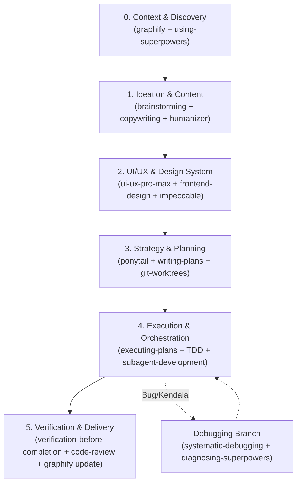

# Workflow: Superpowers Master Pipeline

Gunakan workflow ini saat merancang fitur baru, merombak antarmuka, atau menyelesaikan task teknis end-to-end agar seluruh skill terpakai optimal.



---

## Tahap 1: Query Arsitektur & Context
Sebelum menyentuh kode, petakan dependensi target:
```powershell
# Cek relasi dan model kunci via MCP / CLI
graphify query "<nama fitur atau komponen target>"
```
* **Skill Terlibat:** `graphify`, `using-superpowers`, `antigravity-guide`.
* **Output:** Daftar entitas yang terhubung dan batas arsitektur (*god nodes* & dependensi).

---

## Tahap 2: Brainstorming & Tone of Voice
1. Eksplorasi kebutuhan user dan diskusikan opsi pendekatan menggunakan skill `brainstorming`.
2. Validasi teks antarmuka (copy, pesan error, label button) dengan skill `copywriting` dan `humanizer` untuk memastikan nada tulisan manusiawi dan berkarakter.
3. Gunakan skill `generative_ui` jika memerlukan visualisasi cepat atau wireframe mockup interaktif.
4.gunakan kemampuan `grill_me` untuk menghindari asumsi

---

## Tahap 3: Standar UI/UX & Desain Anti-Slop
1. Rujuk token warna, hierarki tipografi, dan panduan WCAG dari skill `ui-ux-pro-max` & `frontend-design`.
2. Lakukan audit deteksi antipattern desain:
```powershell
.\.agents\skills\impeccable\scripts\impeccable.cmd detect --json <file-komponen-target>
```
* **Skill Terlibat:** `impeccable`, `ui-ux-pro-max`, `web-design-guidelines`.
* **Target:** Tidak ada border side-tab yang tidak disengaja, rasio kontras teks >= 4.5:1 (AA), serta patuh token `DESIGN.md`.

---

## Tahap 4: Strategi Solusi Minimalis & Rencana Aksi
1. Terapkan prinsip `ponytail` (YAGNI): Pilih implementasi yang paling ringkas dan efektif.
2. Buat rencana implementasi spesifik dengan skill `writing-plans`.
3. Jika perubahan berskala sedang/besar, buat isolasi cabang menggunakan skill `using-git-worktrees`.

---

## Tahap 5: Implementasi TDD & Eksekusi Subagent
1. Buat test otomatis terlebih dahulu sesuai metodologi `test-driven-development` (TDD).
2. Jalankan implementasi langkah demi langkah dengan `executing-plans`.
3. Jika terdapat 2+ modul terpisah (misalnya backend API dan styling frontend), delegasikan menggunakan `dispatching-parallel-agents` dan `subagent-driven-development`.
4. Jika menemui bug, gunakan alur `systematic-debugging` (Reproduksi -> Hipotesis -> Perbaikan Terisolasi).

---

## Tahap 6: Verifikasi Mutlak, Review, & Sync Graph
Sebelum menyatakan selesai:
1. Jalankan perintah verifikasi wajib (skill `verification-before-completion`):
```powershell
npm run build
# Dan jalankan automated test yang relevan
```
2. Jalankan evaluasi code review mandiri via `requesting-code-review`.
3. Selesaikan integrasi branch / worktree via `finishing-a-development-branch`.
4. **Pembaruan Graph (Wajib):** Perbarui relasi knowledge graph:
```powershell
graphify update .
```
Semua artefak dan status keterhubungan kode kembali sinkron dan siap untuk iterasi berikutnya.

